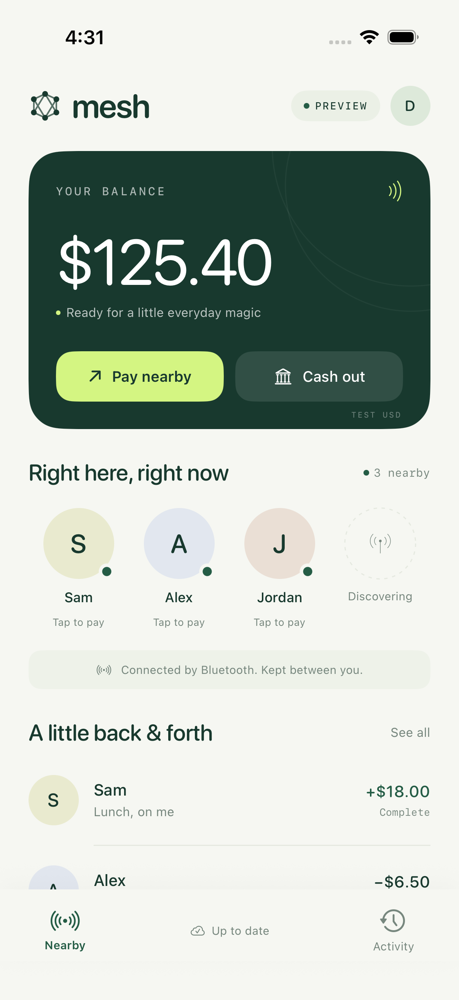

# Mesh

Nearby payments, with a Rust protocol and ledger and a small native SwiftUI app.

Open Mesh, tap someone nearby, enter an amount, and confirm with Face ID or your device passcode. The phones exchange encrypted, signed payment instructions over Bluetooth. Either person can submit the instruction when they have internet access. The server checks available funds and records the result idempotently; provider-backed payments remain pending until processing is confirmed.

**This is a working USD sandbox, not a live money service.** Offline instructions remain pending and can fail. Plaid Sandbox linking and Dwolla Sandbox wallet funding, nearby payments and cash outs are implemented. The default local mode uses a demo payout flow. No real money moves.



## Documentation

Start with the [documentation index](docs/README.md) or the [plain-language walkthrough](docs/HOW_IT_WORKS.md). The guides explain how offline delivery becomes a payment, how the bank connection works, and how to run and extend the code.

| Topic | Guide |
|---|---|
| Setup, builds, previews, and tests | [Development](docs/DEVELOPMENT.md) |
| Components and design decisions | [Architecture](docs/ARCHITECTURE.md) |
| States, retries, and failures | [Payment lifecycle](docs/PAYMENT_LIFECYCLE.md) |
| Signatures, encryption, and HTTP actions | [Protocol](docs/PROTOCOL.md) · [API reference](docs/API.md) |
| Balances, reservations, returns, and storage | [Ledger](docs/LEDGER.md) |
| Native interface and C ownership contract | [iOS and Rust](docs/IOS_RUST.md) |
| Configuration, backups, and diagnosis | [Operations](docs/OPERATIONS.md) · [Troubleshooting](docs/TROUBLESHOOTING.md) |
| Trust, privacy, and current limits | [Security boundaries](docs/SECURITY_BOUNDARIES.md) |

## Try it

Requires Rust stable, macOS on Apple silicon, and Xcode with an iOS simulator. Rust is also enough to run the server and command-line demo on macOS or Linux.

```sh
export PATH="$HOME/.cargo/bin:$PATH"
MESH_RAIL=demo ./scripts/demo.sh
```

The demo creates two wallets, encrypts a payment, delivers its BLE fragments out of order, settles it through the HTTP server, retries without double charging, and reserves a cash out to a demo bank. It starts its own temporary server and stops it on exit.

Start the app's server in one terminal:

```sh
cargo run -p mesh-server
```

Build the app in another:

```sh
./scripts/ios.sh
open ios/MeshPay.xcodeproj
```

The script builds Rust for iPhone and simulator, downloads the pinned official Plaid SDK with a SHA-256 check, and builds the app. Choose a simulator and run the MeshPay scheme in Xcode. Enter your name, leave the development server as `http://localhost:8787`, and add test funds. Each wallet can receive $125.40 once. There are no preloaded people in the normal app.

For a visual preview with sample people and history, add `--preview` under the scheme's Run arguments. That mode does not start Bluetooth, contact the ledger, persist sample data, or allow payments.

## Try two iPhones

1. Run `MESH_BIND=0.0.0.0:8787 cargo run -p mesh-server` on your Mac.
2. Select your Apple development team in Xcode and install the app on both phones. Use a device passcode. Both wallets must use the same server/database.
3. Set the server address in each app to your Mac's local address, for example `http://192.168.1.10:8787`. Connect once and add test funds on one phone.
4. Open Mesh on both devices and allow Bluetooth/local network access. Your friend's signed nearby identity appears. Compare the identity codes in Settings before paying.
5. Disable Wi-Fi and cellular data while leaving Bluetooth on. Make a payment: it stays pending. Reconnect either phone; the server checks the funds and settles it. Reopen the other app to sync its balance.
6. In Cash out, choose the demo bank and cash out some test money. It completes after a few seconds and survives a server restart.

The simulator cannot validate physical BLE radio behavior. Multi-hop relay, reconnects, locked-screen delivery, and battery behavior still need testing on real devices. iOS can delay or suspend background discovery. See [device verification](docs/DEVICE_TESTING.md).

## Bank linking

Plaid LinkKit 7.2.2 is integrated into the native bank screen. To use real Plaid Sandbox rather than the local demo bank, set `PLAID_CLIENT_ID`, `PLAID_SECRET`, and `PLAID_REDIRECT_URI` in the server environment. Follow [the bank integration guide](docs/BANKING.md), including the Universal Link configuration. The server currently reads environment variables directly; `.env.example` is a reference, not an automatically loaded file.

Plaid's Transfer product explicitly does not support peer-to-peer transfers. This project uses Link/Auth for account linking and keeps money movement separate. A production launch needs a processor approved for this wallet/P2P use case, a custody/funding arrangement, identity verification, reconciliation and returns handling, and operational hardening. Setting a production environment variable will not enable real money: the server refuses it.

## Bank-backed Sandbox

Use a fresh database and set `MESH_RAIL=dwolla_sandbox`, `MESH_DATABASE`, and the Plaid/Dwolla Sandbox settings in `.env.example`. In Bank, create a synthetic test wallet, connect a Plaid test bank, then choose Add money. Deposits become spendable after Dwolla confirms processing. Nearby payments and cash outs reserve funds while awaiting the provider. [Detailed setup](docs/BANK_PROVIDER.md).

After exporting your settings, run `cargo run -p mesh-server -- --check-banking` to find configuration gaps without creating a database or contacting providers. Then run `cargo run -p mesh-server -- --probe-banking` to verify Dwolla authentication and Plaid Auth Link token creation with your Sandbox accounts. The probe does not move funds; the full app flow still needs external acceptance testing.

Demo funds cannot be converted to provider-backed balances. A database is permanently pinned to its payment rail. This prevents the test-money faucet from ever funding bank transfers. External Sandbox calls still require validation with your own accounts.

## Layout

| Component | Responsibility |
|---|---|
| `crates/mesh-core` | Exact cents, Ed25519 identities/signatures, X25519 + HKDF + ChaCha20-Poly1305 sealed packets, replayable wire models, bounded BLE framing |
| `crates/mesh-ffi` | Small owned-string C ABI for Swift; Rust payment rules on device |
| `crates/mesh-server` | Signed HTTP requests, SQLite double-entry ledger, atomic/idempotent settlement, encrypted Plaid tokens, durable sandbox cash outs |
| `crates/mesh-banking` | Dwolla Sandbox API, durable transfer outbox, multi-leg reconciliation, webhook authentication and acceptance runner; atomic app ledger bridge and recoverable bank setup |
| `crates/mesh-cli` | Two-wallet end-to-end demo using the actual protocol and HTTP API |
| `ios/MeshPay` | SwiftUI, CoreBluetooth, Keychain, local journal storage, device authentication, Plaid SDK presentation |

Swift is limited to UI and Apple platform adapters. The payment protocol, cryptography, amount validation, packet fragmentation/reassembly, relay decisions and authoritative accounting are Rust. The CoreBluetooth platform bridge and SwiftUI presentation use Swift as required by iOS APIs.

## Verify

```sh
./scripts/check.sh
MESH_RAIL=demo ./scripts/demo.sh
MESH_IOS_DESTINATION='platform=iOS Simulator,id=YOUR-SIMULATOR-UUID' ./scripts/ios.sh test
```

Tests cover signatures and tampering, confidentiality, hostile framing, expiry, request replay, unauthorized submission, concurrent overspending, exact-once settlement, terminal declines, conservation of funds, transaction rollback, database restart, encrypted bank tokens, payout retries, and native screen navigation. The Xcode project and scheme are checked in; `generate-xcode.py` updates source references after adding Swift files. Generated frameworks/build outputs are ignored.

Read [the protocol](docs/PROTOCOL.md), [architecture and boundaries](docs/ARCHITECTURE.md), and [bank integration](docs/BANKING.md) before extending it.

For a US launch, [the partner comparison](docs/PARTNER_DECISION.md) recommends evaluating Dwolla Balance + Plaid Auth first, with Increase as an alternative. Eligibility and a viable commercial quote must be confirmed before selecting the live rail.

The [Rust bank-provider guide](docs/BANK_PROVIDER.md) documents the implemented Dwolla transport/outbox and how to verify external Sandbox credentials. Select `MESH_RAIL=dwolla_sandbox` with a new database and your Sandbox keys to use the bank-backed app flow. The default rail remains the local demo. Bank setup is saved before network handoff, retries keep their original intent ID, and interrupted/expired sign-ins offer a fresh session.

## References

- [Bitchat](https://github.com/permissionlesstech/bitchat): Bluetooth mesh inspiration. Mesh has its own protocol and is not wire compatible.
- [Apple Core Bluetooth background behavior](https://developer.apple.com/library/archive/documentation/NetworkingInternetWeb/Conceptual/CoreBluetooth_concepts/CoreBluetoothBackgroundProcessingForIOSApps/PerformingTasksWhileYourAppIsInTheBackground.html).
- [Plaid Auth](https://plaid.com/docs/auth/add-to-app/) and [Plaid's P2P limitation](https://plaid.com/docs/transfer/creating-transfers/).
- [Plaid's native iOS SDK](https://plaid.com/docs/link/ios/).
