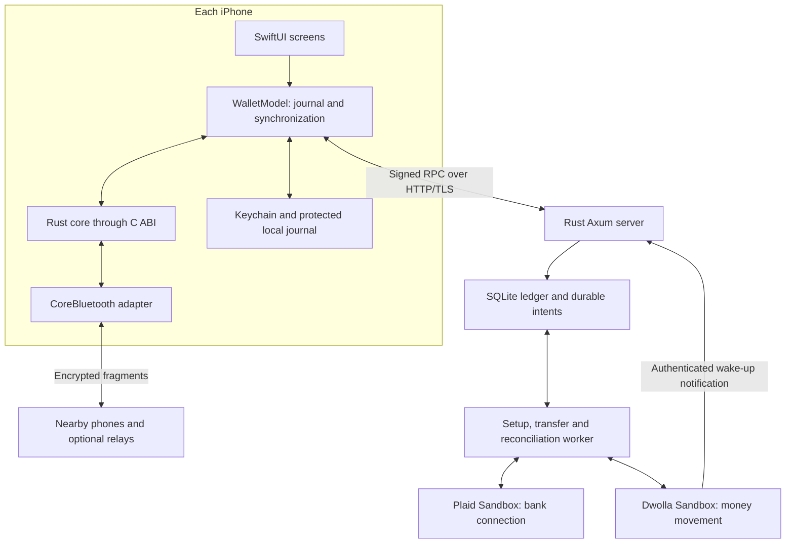

# Architecture and boundaries

[Documentation index](README.md) · [Product walkthrough](HOW_IT_WORKS.md)

Mesh has two communication paths that share an identity: Bluetooth moves a signed payment instruction between nearby phones; signed HTTP submits that instruction to its ledger. Receiving ciphertext is a transport event. Crediting spendable money is an accounting event. This distinction permits offline delivery without claiming final offline settlement.

## Component map

The arrows describe logical data flow; neither the ledger nor a Bluetooth adapter calls an external banking API while holding an accounting transaction. Default demo mode substitutes local simulated funding/payout behavior for external transfers.

| Component | Responsibility | Entry point |
|---|---|---|
| `mesh-core` | Amount rules, identities, signed profiles/payments/RPC, packet encryption, bounded framing and relay decisions | [`lib.rs`](../crates/mesh-core/src/lib.rs) |
| `mesh-ffi` | JSON command dispatch behind a small owned-string C interface | [`lib.rs`](../crates/mesh-ffi/src/lib.rs) |
| Native app | Screens, device confirmation, Keychain/files, CoreBluetooth, URLSession, Plaid SDK lifecycle | [`WalletModel.swift`](../ios/MeshPay/WalletModel.swift) |
| `mesh-server` | Signed API authorization, wallet snapshots, ledger invariants, rail selection and worker orchestration | [`lib.rs`](../crates/mesh-server/src/lib.rs), [`main.rs`](../crates/mesh-server/src/main.rs) |
| `mesh-banking` | Fixed Sandbox transport, durable idempotent transfer outbox, authenticated notifications and observations | [`lib.rs`](../crates/mesh-banking/src/lib.rs) |
| `mesh-cli` | Two-wallet local protocol/HTTP demonstration | [`main.rs`](../crates/mesh-cli/src/main.rs) |

## Why Rust and Swift are split this way

Rust owns rules that must agree on phone and server: exact cents, identity/signature formats, instruction expiry, packet encryption, reassembly, and payment validation. The authoritative ledger and banking orchestration are also Rust. Swift provides native presentation and Apple-only interfaces, including CoreBluetooth, Keychain, device authentication, network lifecycle, and LinkKit presentation.

The C ABI passes UTF-8 JSON and owns its returned allocations. Swift does not reproduce the signing serialization or monetary parser. The engine contains reassembly state and requires exclusive access; the app's wrapper uses the main actor. See [iOS/Rust integration](IOS_RUST.md) for ownership, commands, and storage behavior.

## Transport path

1. A signed nearby profile supplies the recipient's signing and encryption keys.
2. Rust creates a candidate ledger-bound signed payment and encrypts it for that recipient. The phone requests device confirmation and rechecks available funds before releasing it.
3. The phone persists its confirmed journal entry before sending. Rust fragments the packet to the radio's usable frame size.
4. CoreBluetooth delivers frames through writes/notifications with platform backpressure. Rust verifies reassembled packets and suppresses recent duplicates.
5. The recipient decrypts and validates the instruction, then saves it for synchronization. An intermediate honest relay can forward ciphertext within the hop budget without learning the amount/memo.

The originating wallet keeps its outgoing instruction across restart; intermediary queues are memory-only. Radio queues and assemblies are bounded. iOS may delay or suspend background work. The four-hop counter limits honest relays but is not a signed defense against malicious routing. Read [protocol](PROTOCOL.md) and [device testing](DEVICE_TESTING.md) before changing those assumptions.

## Synchronization and authority

The app refreshes its signed profile, registers, obtains a snapshot, and reconciles saved work. Each HTTP attempt uses a fresh signed RPC nonce; financial/setup retries retain their immutable intent ID. Pending work survives restart and blocks an unsafe server switch. Either payment participant may submit the inner signed instruction, so the sender does not have to reconnect first.

The server verifies the caller, instruction, ledger UUID, expiry, recipient registration and available funds. In demo mode, payment debit, credit, balanced journal, and receipt commit in one immediate SQLite transaction. Concurrent requests cannot create a negative user balance. A saved insufficient-funds rejection remains terminal. An existing receipt remains retrievable after the original instruction expires.

In provider mode, payment/cash-out acceptance reserves funds and atomically creates the outbox/request records. The recipient is credited only after an authoritative processed observation. The snapshot exposes active reservation IDs so the client does not subtract a server hold twice. The [lifecycle](PAYMENT_LIFECYCLE.md) and [ledger](LEDGER.md) guides describe the exact transitions.

No client cache, radio acknowledgement, or self-signed profile is proof of funds. A modified offline client can issue competing instructions; the server's funds checks decide their outcome. Both wallets initially require online registration on the same ledger. Fully offline peers cannot create final double-spend-proof dollars through this protocol alone.

## Provider orchestration

Customer and bank setup use encrypted, recoverable phases. The server commits an intent before acknowledging it, saves resource IDs between external mutations, and retains immutable bank-link receipts. A one-time Plaid token consumed before its response is saved may require a fresh sign-in; it does not silently authorize a new transfer.

Transfers use a durable outbox with stable idempotency/correlation IDs, leases, bounded resubmission, and polling of known provider IDs. Observations verify resource identity, amount and related legs. Webhooks authenticate raw bytes and wake reconciliation; they do not directly credit accounts. No external call is part of the SQLite reservation transaction.

Outbox events are applied with the corresponding accounting flags and consumed cursor in one transaction. Confirmed deposit returns remove available funds and record shortfall debt. Returned peer/cash-out transfers and ambiguous observations require review. Periodic provider-balance comparison detects drift without creating credits. The worker pauses submissions when initial ledger event application fails. Read [bank-provider integration](BANK_PROVIDER.md) and [operations](OPERATIONS.md).

## Deployment and storage choices

The server is a single process on macOS/Linux using SQLite WAL and an in-process worker. A mutex coordinates application store access; SQLite transactions enforce durable accounting boundaries. The provider outbox uses the same database so a reservation and its job cannot be separated by a crash. This is not a distributed high-availability design.

Each database owns a persistent ledger UUID and is pinned to either `demo` or `dwolla_sandbox`. Demo grants cannot migrate into provider balances. The native target is arm64 iPhone/Apple silicon simulator, iOS 17+. Release server addresses require HTTPS; local HTTP is a Debug development option. Production mode and production provider origins are refused.

Bank/setup credentials are encrypted under a separate server vault key; ordinary financial history is not whole-database encrypted. The phone seed stays in Keychain and its journal uses file protection. Database/key restore, local identity loss, and review states have separate recovery implications: see [operations](OPERATIONS.md) and [security boundaries](SECURITY_BOUNDARIES.md).

## Current implementation limits

The code includes synthetic provider customer setup, deposits, payments, payouts, returns/debt handling, and reconciliation. External provider acceptance and physical BLE/background testing still require the passes in [VERIFICATION.md](VERIFICATION.md). Simulator UI evidence does not establish those behaviors.

A live service needs an approved banking/custody model, production identity and ownership verification, fraud/abuse controls, review/dispute operations, account recovery, key management, disaster recovery, and independent review. The repository has no general review-resolution UI/API, production admission controls, full activity pagination/export, alerting system, or distributed deployment. See [partner decision](PARTNER_DECISION.md) for the proposed US/USD evaluation path.

## Changing this architecture

Treat signed field order and signature domains as compatibility contracts. Treat financial transitions and balanced journal IDs as accounting contracts. A new bank rail needs provider-specific eligibility and recovery decisions before an adapter can be considered complete; switching URLs or replacing a queue callback is insufficient.

Keep network calls outside accounting transactions, persist intent before mutation, preserve stable operation IDs, and validate authoritative provider observations before credit. Change code, relevant guides, and behavioral tests together. Start from [development](DEVELOPMENT.md), then the focused source/contract guide for the component you are changing.
