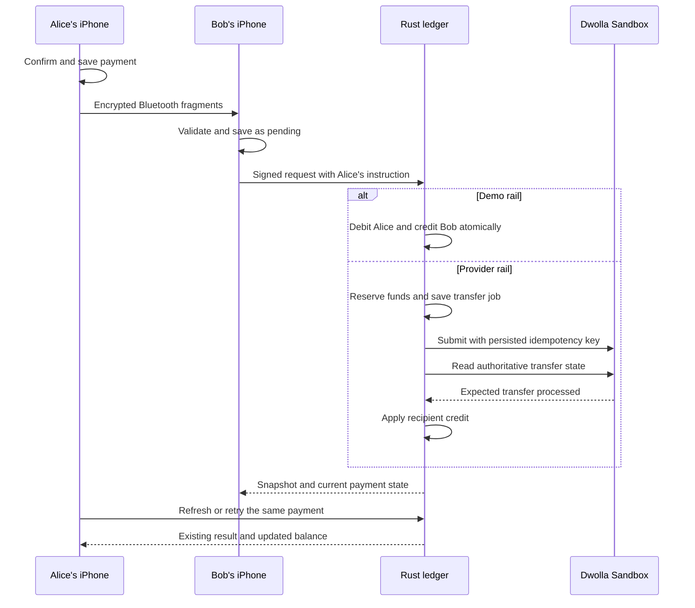

# How Mesh works

[Documentation index](README.md)

Mesh lets you choose someone physically nearby, enter an amount, and confirm a payment on your iPhone. Its design has two connected parts: a small network between phones, and an online authority that decides whether a payment can actually move money.

## A payment from Alice to Bob

Suppose Alice has $20 available and wants to pay Bob $5 for coffee.

1. Both people open Mesh with Bluetooth enabled. Their phones advertise the Mesh service and read each other's signed nearby profile.
2. Alice taps Bob. The profile contains Bob's signing and encryption public keys as well as his display name. Comparing the identity code with Bob helps distinguish him from another person using the same name.
3. Alice enters $5. Rust validates the amount and creates a signed instruction with a unique payment ID, the shared ledger ID, Bob's public key, and an expiry.
4. The phone asks Alice to confirm using Face ID or her device passcode. It rechecks her locally available amount after that prompt.
5. Alice's phone saves the instruction and encrypted packet to its local journal before sending anything. Its displayed available amount falls to $15 while the payment is pending.
6. Bluetooth carries encrypted fragments to Bob. Bob's Rust engine reassembles them, verifies the outer signature, decrypts the instruction, and verifies Alice's payment signature. Bob saves the received payment as pending.
7. Either Alice or Bob can submit that same instruction when connected to the internet. The server checks the signature, ledger, expiry, permissions, and authoritative balance.
8. In the default demo rail, one database transaction moves $5 from Alice to Bob. In the provider rail, the server reserves Alice's $5 and queues a bank-provider wallet transfer. Bob is credited after the expected provider processing is observed.
9. Both phones refresh their server snapshots. Repeated delivery and retries use the same payment ID, so an existing result can be returned without another debit.

Bob cannot spend the pending $5 merely because a nearby phone delivered it.

## What works without internet

Once wallets have connected to the same server and obtained the necessary setup information, nearby discovery and instruction delivery can work over Bluetooth. No internet connection is needed to fragment, carry, verify, or decrypt the packet.

Internet is still needed to register with the ledger, obtain an authoritative balance/result, verify provider wallets, connect a bank, fund the wallet, or cash out. An offline phone works from a cached balance and its own pending journal. That cache is useful for the interface; it is not proof that competing instructions do not exist.

If Alice signs two offline instructions that exceed her balance, the server can accept only what the authoritative funds allow. The other instruction can fail. Instructions also expire after at most 24 hours. The design does not promise final offline dollars.

## What “mesh” means here

Phones can carry encrypted packets for other phones. An intermediary validates the signed envelope and can forward it without reading its payment amount or memo. Honest forwarding starts with a four-hop budget and decrements it.

The nearby list shows directly discovered people. It is not a searchable global directory. Relay storage is bounded and held in memory; an intermediary leaving range or being terminated can interrupt delivery. The original wallet's own outgoing journal survives restart and can be rebroadcast.

The hop count is mutable and cannot prove how many radios actually relayed a packet. See the [protocol's transport limits](PROTOCOL.md#sealed-mesh-packets).

## What Plaid and Dwolla each do

Mesh presents Plaid's native Link interface to connect a selected test bank account. The Rust server fetches account information rather than trusting the label or account selection supplied by a phone.

For the provider-backed Sandbox rail, the server turns that connection into a Dwolla bank funding source associated with the wallet's verified test customer. The Dwolla adapter then submits funding, wallet-to-wallet, and cash-out instructions. The server observes their results and updates its internal accounting.

Bluetooth does not carry bank passwords, access tokens, processor tokens, or identity-verification details. Bank setup is a separate signed online flow. [Banking setup](BANKING.md) explains its interruption and retry behavior.

## The three ways to try it

| Mode | What you see | Financial behavior |
|---|---|---|
| `--preview` app argument | Sample friends, balance, and history | No payment-server calls or saved-wallet writes; no Bluetooth startup |
| Default `demo` server rail | Real local wallets and signed requests | One $125.40 faucet grant per wallet key; local simulated payouts |
| `dwolla_sandbox` server rail | Synthetic verified wallets and linked test banks | Provider jobs, pending deposits, reservations, and reconciled Sandbox transfer states |

The preview still initializes the app's wallet/Keychain adapter; it is not a separate seedless application. Its sample journal and balance are not persisted.

The two server rails use separate databases. A database's rail is pinned, so demo funds cannot become provider-backed funds by changing an environment variable. All three modes remain test-only; production bank API origins are disabled.

## Trust and current limits

A signature proves control of a wallet key. It does not prove that a nearby display name belongs to your friend, that the wallet has funds, or that a bank transfer has completed. Identity codes help compare keys; the ledger and provider supply financial checks.

The server sees submitted payment amounts, memos, and participants. Radio observers can still see routing public keys, timing, and sizes. This is confidential payment transport, not an anonymous payment network.

There is no account/key recovery flow yet. Physical iPhone radio behavior and external banking acceptance need their own tests; simulator screens and local provider mocks cannot prove them. Read the [verification record](VERIFICATION.md) for the evidence available today.
