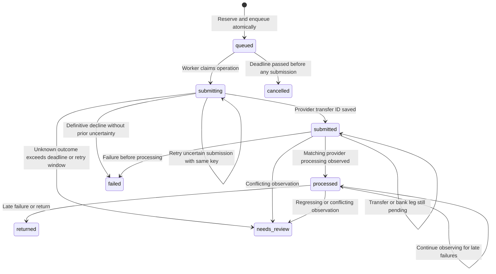

# Payment lifecycle and recovery

[Documentation index](README.md) · [Accounting details](LEDGER.md)

A payment has several representations: a signed instruction, an encrypted radio packet, a local journal entry, and possibly a provider job. They share identifiers where appropriate, but their states answer different questions.

## Identifiers and their jobs

| Identifier | Created by | Retained across retry? | What it prevents or identifies |
|---|---|---|---|
| Wallet signing key | Rust/device seed | Yes | Who authorized the instruction/RPC |
| Ledger UUID | Server database | Yes | Which authority may accept an instruction |
| Payment UUID | Rust `Payment::new` | Yes | One immutable payment instruction and its envelope |
| Cash-out/funding UUID | Client before HTTP | Yes | One explicit bank transfer intent |
| Bank-link intent UUID | Client before HTTP | Yes | One immutable user bank-connection attempt |
| RPC nonce | Rust `SignedRequest::new` | **No: fresh per attempt** | Replay of one HTTP request |
| Provider transfer UUID | Provider | Yes after receipt | The external transfer to observe without reposting |
| Worker lease UUID | Worker claim | No | Which worker may persist this attempt's result |

Generating a new payment ID after a timeout is not retrying: it is authorizing another instruction. Reusing an RPC nonce is not deduplication: it is a replay that the server rejects.

## Before the server knows about a payment

The phone checks its cached available amount and constructs a candidate signed payment/packet in Rust. It then asks for device-owner authentication, rechecks available funds, and saves the confirmed intent before any Bluetooth or HTTP side effect. A successful file write is required before the outgoing instruction is broadcast. Device confirmation gates release in the native app; it is not encoded as a biometric proof in the signed payment.

For an incoming packet, Rust validates and decrypts it before Swift saves it. The local entry remains `pending`; the receiver does not credit its own balance. Duplicate local payment IDs are ignored. Incoming pending storage is bounded, and malformed fragments never become wallet payments.

The outgoing wallet can rebroadcast pending instructions on new Bluetooth connections and when the app returns to the foreground. Intermediate relay queues are different: they are bounded, memory-only, and not a durable delivery service.

## Default demo settlement

`Store::settle` authenticates the submitting participant, matches the ledger, checks an existing receipt or rejection, verifies a new instruction, and checks available funds. A successful immediate SQLite transaction debits the sender, credits the recipient, inserts balanced journal entries, and saves the receipt.

An insufficient-funds decision writes a rejection tombstone. This prevents an old declined instruction from unexpectedly becoming valid after a later top-up. An already recorded matching payment can return its receipt after its original expiry; a new expired payment cannot settle.

Demo cash outs reserve wallet funds first and are processed by the local worker after they are at least three seconds old. The two-second worker tick and scheduling mean this is not a precise three-second completion guarantee.

## Provider-backed settlement

A new provider payment needs both wallets to have eligible verified customer/balance records. The server reserves the sender's money and creates the immutable outbox job in **one transaction**. It does not call the provider inside that transaction.

This is a guide to the important paths, not a list of every provider response combination. [`outbox.rs`](../crates/mesh-banking/src/outbox.rs) defines the actual transitions. For example, cancellation observed after processing enters review rather than being treated as a proven refund.

| Internal state | Meaning for the wallet |
|---|---|
| `queued` | Intent committed; a payment/cash-out reserve already exists |
| `submitting` | Submission may be in flight or its result uncertain |
| `submitted` | Known external transfer ID; awaiting observation/processing |
| `processed` | Expected provider result observed; ledger applies its effect and exposes `settled` |
| `failed` / `cancelled` | Before processing, release any reservation once |
| `returned` | Apply the implemented return policy; completion is not permanent bank irrevocability |
| `needs_review` | Stop automatic progress and freeze affected wallet spending |

Funding has no recipient credit until processing. Payments move the reserve to the recipient. Cash outs move the reserve to provider clearing. The event consumer and its cursor commit together, so a restart cannot advance past an unapplied accounting event.

## Failure cases, explicitly

| Failure point | Durable evidence | Recovery |
|---|---|---|
| App stops before saving a new payment | No journal entry; no authorized broadcast from this path | User can create a payment again |
| App stops after saving, before radio delivery | Original payment/packet journaled | Reopen and rebroadcast/sync the same instruction |
| Recipient receives only some fragments | Incomplete bounded assembly, no validated payment | Redelivery can complete it; no partial credit |
| HTTP response is lost | Client retains operation ID | Fresh RPC nonce, same operation ID, then refresh snapshot |
| Server fails while reserving/enqueuing | SQLite transaction | Both reservation/job commit, or neither commits |
| Provider accepts but response is lost | Job and original provider key persisted | Retry same immutable submission within its allowed window |
| Worker result arrives after lease expiry | Old fencing token | Stale worker cannot overwrite the new worker's result |
| Processed job is observed again | Applied flag and committed event cursor | No additional financial credit |
| Notification is duplicated or out of order | Authenticated event digest and transfer lookup | Reconcile provider state; notification topic alone changes no money |
| New instruction expires before any provider attempt | Deadline plus no prior submission | Cancel and release reserve |
| Instruction expires after an unknown attempt | Possible external side effect | Review; do not infer failure or generate a replacement transfer |

The retry cutoff is a code policy: unknown submissions stop at 23 hours from first submission. A known transfer ID can still be observed beyond that window. Local fencing and idempotency reduce duplicate risk; they do not prove arbitrary external execution is exactly once under unlimited process/network failures.

## What the iPhone displays

The local journal uses `pending`, `settled`, and `failed`. Provider snapshot rows carry more detailed states; the Activity screen can show pending, returned, cancelled, or review outcomes.

The client only marks completion from a `settled` server result. It refreshes the snapshot before releasing an uncertain cash-out reservation. A provider payment already reserved server-side is excluded from a second local subtraction. If a snapshot has not arrived, the client keeps its saved intent and treats the result as uncertain.

Clock synchronization matters twice: signed HTTP requests have a 120-second window, while payment instructions last at most 24 hours. Fix a wrong device clock rather than regenerating IDs to bypass expiry or replay checks.

## Returns and bank setup

A returned deposit removes unspent money and records any spent shortfall as debt. Other returned transfers may require manual review. Worked entries are in [LEDGER.md](LEDGER.md#returned-deposit-example).

Bank setup has its own sequence and failure boundary, separate from money movement: public-token exchange → account validation → processor token → Dwolla exchange → verified bank source. An expired sign-in before Dwolla resources exist can be restarted safely with a new Link intent. An ambiguous money transfer must not use that same restart strategy. See [bank setup recovery](BANKING.md#interrupted-bank-setup).
